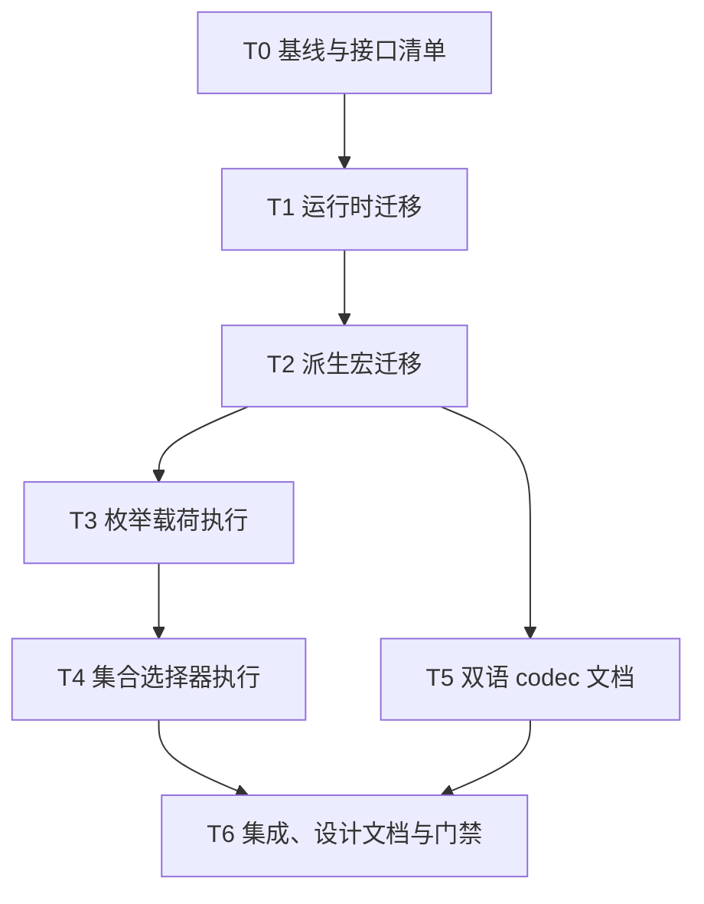

# rs-model-metadata 与 rs-reflect v3 集成及校验能力扩展实施计划

> 面向执行者：按任务依赖顺序实施；每项用 `- [ ]` 跟踪。此文件是实施计划，不表示代码已修改或测试已通过。设计依据见 [配套设计文档](design-20261013T114958960Z-3f9ef137.md)。

**目标：** 恢复当前 `rs-reflect`、`rs-model-metadata`、`rs-platform` 的可编译集成，扩展指定校验执行形状，补齐双语 codec 教程。

**架构：** 模型运行时与派生宏共同迁移至 `rs-reflect` v3 动态值和过程宏契约；校验执行仍通过声明遍历、能力检查、绑定、实例执行四阶段。新增安全的变体及集合借用 adapter，不让构建成功的计划遗漏规则。

**技术栈：** Rust 1.94、edition 2024、Cargo workspace、`qubit-reflect`、`qubit-validator`、`qubit-codec`、trybuild、现有 Markdown 示例测试。

**工作目录：** `/data/working/qubit/rust-common/rs-model-metadata`，直接使用当前 Paseo workspace；不创建新的 Paseo workspace。本计划及设计由用户指定保存在 `doc/`，不使用临时目录。

## 全局约束

- 只改动此目标所需的运行时、派生宏、测试、文档和经证实受影响的下游调用点；不得整体覆盖任何候选工作树的未提交改动。
- 用户允许破坏性 API 调整；不恢复 `Reflected*` 或 `reflect_impl` 兼容入口。运行时与派生宏私有 ABI 改动必须同步。
- 不把校验不支持形状转换为无规则的成功计划；执行错误保留来源、路径、预算状态及部分报告。
- 文档和应用代码使用公开 API；`__private` 仅供生成代码。中英文文档语义对齐，示例分别从原文抽取验证。
- 未获用户明确授权，不执行 `git add`、`git commit` 或 `git push`；实施过程中只记录可审查的 diff 与验证证据。
- Rust 源码、测试和 Rustdoc 的实际修改须先读取适用的项目规则与 `~/.agents/specs/rust-coding.mdc`、`rust-test.mdc`、`rust-comment.mdc`；修复已确认缺陷还须读取 `bug-fix.mdc`。

## 文件地图

| 范围 | 主要文件与职责 |
| --- | --- |
| v3 动态值门面与访问 | `src/__private.rs`、`src/property.rs`、`src/property_access_path.rs`、`src/access_path/property_access_write_failure.rs`、`src/resolve/graph.rs`、`src/registry/model_registry.rs`；完成受检字段访问和恢复语义迁移。 |
| v3 宏生成 | `derive/src/expand/model_impl.rs`、`derive/src/expand/fields.rs`、`derive/src/expand/pipeline.rs`；生成 `ReflectImpl` 和新 adapter。 |
| 校验执行 | `src/validation/internal/declaration_walker.rs`、`occurrence_binder.rs`、`path_reader.rs`、`src/validation/compiled_property_path.rs`、`src/validation/validation_plan/execute.rs`、`src/property.rs`；新增变体与集合执行步骤。 |
| 回归 | `tests/validation_capabilities_tests.rs`、`tests/model_validation_tests.rs`、`tests/codec_binding_tests.rs`、`derive/tests/model_impl_contract_tests.rs` 及已有相邻测试；按实际变更添加聚焦测试。 |
| 文档 | `doc/user_guide.md`、`doc/user_guide.zh_CN.md`、`doc/design.md`、`doc/design.zh_CN.md`、`tests/documentation_examples_tests.rs`；补齐流程、能力边界和可执行示例。 |
| 下游 | `/data/working/qubit/rust-common/rs-platform/modules/model-runtime` 与实际编译报错的模型消费者；只处理本次 API 迁移导致的调用点。 |

## 调度图

| 任务 | 前置任务 | 最小解锁产物 | 写入集合 | 本地验证 | 集成验证归属 | 审查时机 |
| --- | --- | --- | --- | --- | --- | --- |
| T0 基线与接口清单 | 无 | 旧符号、v3 替代入口、失败命令记录 | 只读 | `cargo check -p qubit-model-metadata --lib --locked`（预期先失败） | T6 | 立即审查 |
| T1 运行时迁移 | T0 | 核心库默认 feature 编译、动态值错误语义测试 | `rs-model-metadata/src/**` 中反射门面、属性、路径、注册表、图；对应 `tests/**` | `cargo test -p qubit-model-metadata --lib --locked` | T6 | 立即审查 |
| T2 派生宏迁移 | T1 | `ModelImpl` 生成代码可编译，运行时与宏 ABI 一致 | `rs-model-metadata/derive/src/**`、`derive/tests/**`、受影响的宏 fixture | `cargo test -p qubit-model-derive --locked` | T6 | 立即审查 |
| T3 枚举载荷执行 | T2 | 活动变体字段可校验，非活动变体跳过 | `src/validation/internal/declaration_walker.rs`、`occurrence_binder.rs`、`compiled_property_path.rs`、`validation_plan/execute.rs`、枚举专项测试 | `cargo test -p qubit-model-metadata --features validation --test model_validation_tests enum_ --locked` | T6 | 立即审查 |
| T4 集合选择器执行 | T3 | 元素、MapKey、MapValue 在限定形状可执行 | `src/property.rs`、`src/validation/**`、`derive/src/expand/fields.rs`、集合专项测试与 fixture | `cargo test -p qubit-model-metadata --features validation --test validation_capabilities_tests --locked` | T6 | 立即审查 |
| T5 双语 codec 文档 | T2 | 两版完整 codec 场景及英文核心流程调整 | `doc/user_guide.md`、`doc/user_guide.zh_CN.md`、`tests/documentation_examples_tests.rs` | `cargo test -p qubit-model-metadata --all-features --test documentation_examples_tests --locked` | T6 | 批量审查；可与 T3 同批 |
| T6 集成、设计文档与门禁 | T4、T5 | 当前三仓库证据与完整文档一致 | `doc/design.md`、`doc/design.zh_CN.md`；必要时下游精确报错文件 | 见 T6 命令清单 | T6 | 立即审查 |

T3 与 T5 在 T2 后可并行，写入集合不相交；其重型 Cargo 命令仍须因共享 `target` 串行执行，或使用各自独立 `CARGO_TARGET_DIR`。T4 修改派生宏文件，必须在 T2 合并并复核后开始。若实际文件归属变化，先更新本表和下面的依赖图，再分派工作。

## 任务拓扑依赖图

## 任务列表

### T0：固定当前基线与 v3 接口清单

- [ ] 记录 `rs-reflect`、目标项目、`rs-platform` 的 `git rev-parse HEAD` 与 `git status --short`；只读检查目标文件和目标文档是否已有未提交改动，不覆盖他人工作。
- [ ] 在目标目录执行 `cargo check -p qubit-model-metadata --lib --locked`，保存首轮完整诊断和退出码；预期仍能复现旧入口缺失，后续结果以实测为准。
- [ ] 搜索 `ReflectedRef|ReflectedMut|ReflectedOwned|reflect_impl` 在 `src/`、`derive/src/`、`tests/`、`benches/` 的使用；逐处标记为公开调用、生成代码、测试或真实内部标识符。
- [ ] 对照 `rs-reflect/src/value/mod.rs`、`src/descriptor/field_descriptor.rs` 和 `src/lib.rs` 核对 `DynamicRef<'a, Local>`、`DynamicMut<'a, Local>`、`DynamicOwned<Local>`、`get_dynamic`、`set_dynamic`、`#[ReflectImpl]` 的签名。记录不能直接一对一替换的调用点及其错误恢复要求。

### T1：迁移运行时反射边界

- [ ] 先在 `tests/property_tests.rs`、`tests/access_path_tests.rs`、`tests/metadata_resolution_error_tests.rs` 中保留或增加聚焦回归：动态借用读取、owned getter、写入前拒绝时替换值可回收、setter 执行后失败不承诺回滚、错类型返回结构化错误。
- [ ] 将 `src/__private.rs` 中旧的 v3 前导出改成现行安全类型与宏入口；按 T0 清单迁移 `src/property.rs`、`src/property_access_path.rs`、`src/access_path/property_access_write_failure.rs`、`src/resolve/graph.rs`、`src/registry/model_registry.rs` 及编译器指出的其他生产调用点。每处优先使用 `FieldDescriptor` 的受检动态方法。
- [ ] 更新 `src/validation/internal/path_reader.rs`、`src/validation/validation_plan.rs`、`src/validation/validation_plan/execute.rs`、`src/validation/model_validation_error.rs` 的动态值签名，保留借用生命周期和部分报告。禁止通过丢弃错误或假设 `Any` 总可用来消除编译错误。
- [ ] 运行 `cargo check -p qubit-model-metadata --lib --locked`，再运行 `cargo test -p qubit-model-metadata --lib --locked`；预期核心库不再报旧入口缺失，T1 回归通过。若因宏开发依赖而受 T2 阻断，记录确切错误，使用 `cargo check --lib` 作为 T1 解锁门禁。

### T2：迁移派生宏及私有 ABI

- [ ] 在 `derive/tests/model_impl_contract_tests.rs`、`derive/tests/model_codegen_boundary_tests.rs` 和现有 trybuild 组中建立 `#[ModelImpl]` getter/setter、可选借用、owned 返回、跨 crate 生成代码的失败前/成功后回归。
- [ ] 将 `derive/src/expand/model_impl.rs` 生成的反射标注改用 `#[ReflectImpl]`；检查 v3 宏实际接受的参数，按现行 parser 生成属性。同步 `derive/src/expand/fields.rs` 的 adapter 输入输出及 `src/__private.rs` 门面。必要时更新 `derive/src/expand/pipeline.rs` 与精确受影响的 fixture、基准。
- [ ] 检查 `__private::v8` 的签名是否仍匹配；若更改则同步 ABI 标识和编译期失配测试，不保留误导性的旧 ABI 版本。更新对应 trybuild `.stderr`，只接受本次契约变化造成的诊断差异。
- [ ] 运行 `cargo test -p qubit-model-derive --locked` 和 `cargo test -p qubit-model-metadata --test model_impl_merge_tests --locked`；预期宏展开、链接和错误边界通过。

### T3：使枚举载荷约束可执行

- [ ] 在 `tests/model_validation_tests.rs` 增加具名与位置载荷的正反例：活动变体执行对应文本规则，非活动变体不执行；错误路径含变体与字段；错误 adapter 返回执行错误与部分报告。保留一个不支持形状的构建拒绝测试。
- [ ] 修改 `declaration_walker.rs`：为枚举 occurrence 保留变体索引和可执行字段位置，不再把全部 `owner.as_enum().is_some()` 统一设为 unsupported；保持原声明顺序与循环拒绝。
- [ ] 在 `occurrence_binder.rs`、`compiled_property_path.rs` 和 `validation_plan/execute.rs` 增加活动变体检查及受检载荷读取。若 `rs-reflect` 当前只提供普通引用的 `VariantDescriptor::is_active`，优先生成窄 adapter；若必须补反射 API，先在 `rs-reflect` 给出具体安全签名与其聚焦测试，再在本项目消费。
- [ ] 运行 `cargo test -p qubit-model-metadata --features validation --test model_validation_tests enum_ --locked` 和受影响的 capability 测试；预期正反例通过，旧“所有 enum payload 必拒绝”测试改为仅覆盖真正未支持的形状。

### T4：使限定集合选择器可执行

- [ ] 在 `tests/validation_capabilities_tests.rs`、`tests/model_validation_tests.rs` 增加 `Vec<T>`、数组、切片、`HashMap<K,V>`、`BTreeMap<K,V>` 的 Element/MapKey/MapValue 成功和违例用例；覆盖空集合、`Option::None`、key 先于 value、预算耗尽、getter 无法借用和仍不支持的自定义容器。
- [ ] 在 `src/property.rs` 的 `CollectionOps` 同层增加安全的借用遍历 adapter；由 `derive/src/expand/fields.rs` 为可证明的具体集合形状生成。保留 `MapLenAdapter` 与 `ItemEqAdapter` 现有行为。生成代码只暴露有效生命周期内的成员借用。
- [ ] 修改 `occurrence_binder.rs` 对 selector 规则的受支持判断，并在 `validation_plan/execute.rs` 中对实际成员逐个执行规则。`MapKey`、`MapValue` 分别记录 `ValidationPath`，外层和内层共享预算；不支持依赖绑定继续在 build 阶段拒绝。
- [ ] 运行 `cargo test -p qubit-model-metadata --features validation --test validation_capabilities_tests --locked`、`cargo test -p qubit-model-metadata --features validation --test model_validation_tests --locked` 和 `cargo test -p qubit-model-derive --locked`；预期无静默跳过，原外层长度/去重规则仍通过。

### T5：完成双语 codec 教程和阅读顺序

- [ ] 以 `tests/codec_binding_tests.rs` 中的真实注册方式为事实来源，在 `doc/user_guide.md` 与 `doc/user_guide.zh_CN.md` 各写完整、独立的 codec 代码块：声明、注册、图、`CodecBindInputs`、`bind_codecs`、成功断言和缺少注册项的错误观察。使用现有 `<!-- example: ... -->` 标记与准确的 `codec` feature 依赖块。
- [ ] 明确 `bind_codecs` 只选择实现，不会调用 codec、持久化或执行应用策略；两版对类型不匹配和缺失注册项的解释一致。
- [ ] 把英文 `Core workflow: validate a profile and keep partial results` 移到元数据/图入门之后、进阶章节之前；修正所有受影响的本地锚点。保留正确示例原文，不因移动而改写行为。
- [ ] 运行 `cargo test -p qubit-model-metadata --all-features --test documentation_examples_tests --locked` 与 `python3 scripts/check_doc_links.py --root . README.md README.zh_CN.md doc/user_guide.md doc/user_guide.zh_CN.md doc/design.md doc/design.zh_CN.md`；预期两个语言的 codec 示例从文档原文运行，链接无缺失。

### T6：更新双语设计文档并完成集成验证

- [ ] 在 `doc/design.md`、`doc/design.zh_CN.md` 更新反射 v3 边界、枚举/集合支持矩阵、仍拒绝的递归和自定义容器形状，以及 codec 绑定与执行的区别；互链与术语保持一致。
- [ ] 在目标目录串行运行 `cargo test --workspace --locked`、`cargo test --workspace --all-features --locked`、`cargo doc --workspace --all-features --no-deps --locked`、项目现有风格和 CI 门禁。只有这些命令真实通过才记录通过；`coverage.json` 等既有产物不能替代本轮输出。
- [ ] 在 `rs-platform` 运行 `cargo check -p qubit-platform-model-runtime --locked`，并运行 `cargo test -p qubit-platform-model-runtime --locked` 及一个实际模型消费者的聚焦测试（优先 `qubit-platform-credential` 的 `credential_info_validation_tests`）。若受本次破坏性 API 影响，再修改精确报错的下游调用点，不扩大到无关模型。
- [ ] 复核 `git diff --check`、`git status --short`、旧符号搜索、README/指南/设计链接与最终测试记录。报告三仓库实际 HEAD、命令、退出码、仍存限制；不得把未运行或被环境阻断的门禁写成通过。

## 规格覆盖自检

| 设计要求 | 对应任务 |
| --- | --- |
| 反射 v3 运行时与宏同步迁移、ABI 失配诊断 | T0、T1、T2 |
| 枚举活动载荷校验与错误路径 | T3 |
| 集合 Element、MapKey、MapValue 与预算、拒绝边界 | T4 |
| 双语可运行 codec 场景与英文指南阅读顺序 | T5 |
| 双语设计、Rustdoc、下游接入、完整验证 | T6 |
